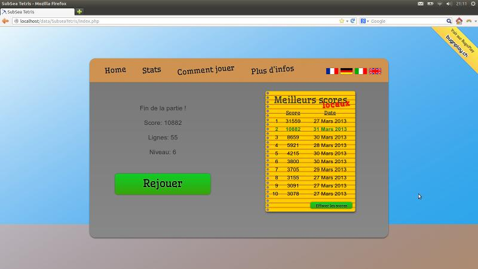
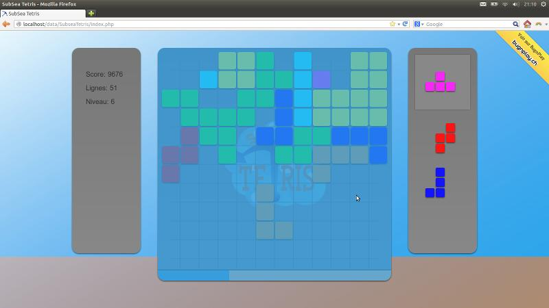
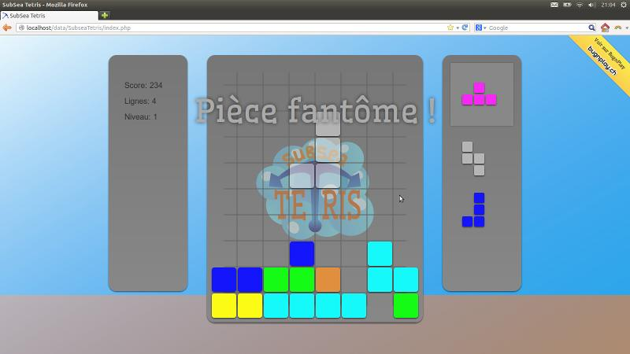
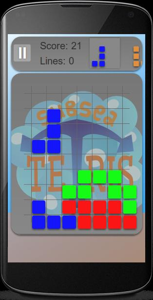

# Subsea Tetris

This is the source code of a javascript tetris I coded for the Swiss Game Competition Bugnplay in 2013.

This water-themed version features floods, gravity inversions, growing field size and ghost pieces!

There are 4 languages avaiables. French, German, Italian and English. 

Play on my website <https://subseatetris.clarkwinkelmann.com/>

Screenshots:

